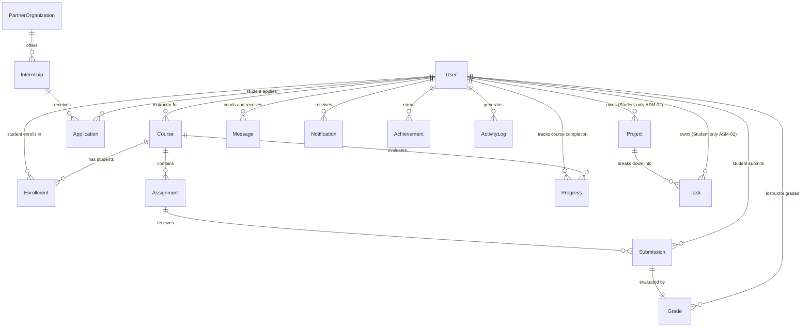

# CampusBridge: Cross-Team API Ownership & Integration Contract

## 1. Team Allocation & Architectural Ownership

The CampusBridge development work is distributed across four distinct developer roles operating on a unified codebase, shared MongoDB database, and unified REST API:

| Developer Stream | Module Scope | Core Functional Responsibilities |
|---|---|---|
| **Developer 1 & Developer 2** | **Student & Instructor** | Academic enrollment, course resource access, assignment submissions, grading queue, progress engine, personal projects & tasks, student internship discovery/applications, AI assistant, achievements, messaging. |
| **Developer 3** | **Coordinator** | Academic course authoring, instructor course assignments, partner organization registry, internship postings, applicant review & corporate forwarding, applicant CSV export. |
| **Developer 4** | **Administrator** | Staff provisioning (instructors, coordinators), user account activation/deactivation, global announcements, landing page CMS blocks, registration toggles, system-wide analytics. |

---

## 2. Cross-Team Dependency Matrix

This matrix formalizes the explicit interface dependencies where the Student and Instructor modules consume services owned by the Coordinator or Administrator streams.

| Functionality | Owning Team | Consuming Team | Required Endpoint / Contract | Input Parameters | Returned Data Payload | Contract Dependency Details |
|---|---|---|---|---|---|---|
| **Course Catalog** | Dev 3 (Coordinator) | Dev 1 & 2 (Student) | `GET /api/v1/coordinator/courses` (or `GET /api/v1/courses`) | `status=active`, `search`, `page`, `limit` | Array of courses with code, title, description, instructor info | Student module queries courses where `status: 'active'` for catalog browsing. |
| **Instructor Assignment** | Dev 3 (Coordinator) | Dev 1 & 2 (Instructor) | `PATCH /api/v1/coordinator/courses/:id/assign` | `instructorId` | Updated `Course` with assigned `instructorId` | Instructor module queries courses where `instructorId: req.user._id` to populate instructor's assigned courses. |
| **Course Archival** | Dev 3 (Coordinator) | Dev 1 & 2 (Student, Instructor) | `PATCH /api/v1/coordinator/courses/:id/archive` | None (or status payload) | Updated course with `status: 'archived'` | When archived, students can no longer enroll and instructors cannot create new assignments. |
| **Internship Postings** | Dev 3 (Coordinator) | Dev 1 & 2 (Student) | `GET /api/v1/internships` | `status=open`, `skills`, `type` | Array of open internships with requirements and company details | Student module displays active internships for student browsing, filtering, and AI matching. |
| **Application Review & Forwarding** | Dev 3 (Coordinator) | Dev 1 & 2 (Student) | `PATCH /api/v1/coordinator/applications/:id/status` | `status` ('Under review', 'Forwarded', 'Accepted', 'Rejected'), `notes` | Updated `Application` with new status and history entry | Triggers in-app notification to student; updates student's application tracking card. |
| **Account Activation / Deactivation** | Dev 4 (Admin) | Dev 1 & 2 (All) | `PATCH /api/v1/admin/users/:id/status` | `active` (boolean) | Updated `User` with `active: false/true` | Central auth middleware (`authenticate`) checks `user.active`. Deactivated users are blocked immediately. |
| **Staff Provisioning** | Dev 4 (Admin) | Dev 1 & 2 (Instructor) | `POST /api/v1/admin/users` | `name`, `email`, `role: 'instructor'`, `department` | Created instructor `User` record | Instructors cannot self-register; accounts must be created by Admin before Coordinators can assign them courses. |
| **System Announcements** | Dev 4 (Admin) | Dev 1 & 2 (Student, Instructor) | `GET /api/v1/announcements/active` | `audience` ('dashboard' or 'both') | Active announcement text, start/end dates | Rendered on Student and Instructor dashboard welcome headers. |
| **Registration Toggle** | Dev 4 (Admin) | Dev 1 & 2 (Student) | `GET /api/v1/settings/registration` | None | `{ registrationOpen: boolean }` | Controls whether public registration is active or returns 403 on register. |

---

## 3. Shared Database Entities & Foreign Key Relationships

---

## 4. Cross-Module Workflow Agreements

### 4.1. Course Creation to Student Assignment Submission
1. **Coordinator** creates course: `POST /api/v1/coordinator/courses` and assigns an instructor.
2. **Student** browses active courses: `GET /api/v1/student/courses` and enrolls: `POST /api/v1/student/courses/:courseId/enroll`.
3. **Instructor** views assigned course: `GET /api/v1/instructor/courses` and adds resources and assignments: `POST /api/v1/instructor/courses/:courseId/assignments`.
4. **Student** receives notification and views assignment: `GET /api/v1/student/assignments/:assignmentId`.
5. **Student** uploads submission: `POST /api/v1/student/assignments/:assignmentId/submit`.
6. **Instructor** views submission in grading queue: `GET /api/v1/instructor/grading-queue` and records score and feedback: `POST /api/v1/instructor/submissions/:submissionId/grade`.
7. **System** recalculates `Progress` for student in course and dispatches notification.

### 4.2. Internship Posting to Student Application Workflow
1. **Coordinator** registers partner organization: `POST /api/v1/coordinator/companies` and creates internship: `POST /api/v1/coordinator/internships`.
2. **Student** searches internships: `GET /api/v1/student/internships` and runs AI skill matching: `POST /api/v1/student/ai/skill-match`.
3. **Student** submits application with CV and message: `POST /api/v1/student/internships/:internshipId/apply`.
4. **Coordinator** reviews application, transitions status to `Under review` and then `Forwarded`: `PATCH /api/v1/coordinator/applications/:id/status`.
5. **Partner Organization** reviews offline; Coordinator records final decision: `Accepted` or `Rejected`.
6. **Student** tracks status in real-time: `GET /api/v1/student/applications`.
