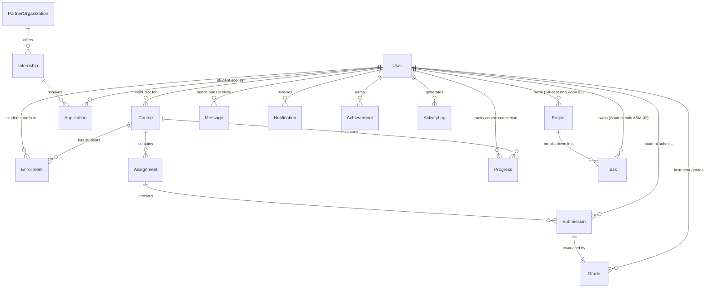

# CampusBridge: Cross-Team API Ownership & Integration Contract
## Strict SRS v2.0 Compliance Baseline

- **Functional Authority**: CampusBridge Software Requirements Specification (SRS) v2.0
- **Base URI Prefix**: `/api/v1`

---

## 1. Team Allocation & Architectural Ownership

The CampusBridge development work is distributed across four distinct developer roles operating on a unified codebase, shared MongoDB database, and unified REST API:

| Developer Stream | Module Scope | Core Functional Responsibilities |
|---|---|---|
| **Developer 1 & Developer 2** | **Student & Instructor** | Academic enrollment, course resource access, assignment submissions, grading queue, progress engine, personal projects & tasks, student internship discovery/applications, AI assistant, achievements, messaging. |
| **Developer 3** | **Coordinator** | Academic course authoring, instructor course assignments, partner organization registry, internship postings, applicant review & corporate forwarding, applicant CSV export. |
| **Developer 4** | **Administrator** | Staff provisioning (instructors, coordinators), user account activation/deactivation, global announcements, landing page CMS blocks, registration toggles, system-wide analytics. |

---

## 2. Cross-Team Dependency Matrix

This matrix formalizes the explicit interface dependencies where the Student and Instructor modules consume services owned by the Coordinator or Administrator streams.

| Functionality | Owning Team | Consuming Team | Required Endpoint / Contract | Input Parameters | Returned Data Payload | Contract Dependency Details |
|---|---|---|---|---|---|---|
| **Course Catalog** | Dev 3 (Coordinator) | Dev 1 & 2 (Student) | `GET /api/v1/courses` | `status=active`, `search`, `page`, `limit` | Array of courses with code, title, description, instructor info | Student module queries courses where `status: 'active'` for catalog browsing (FR-04, FR-05). |
| **Instructor Assignment** | Dev 3 (Coordinator) | Dev 1 & 2 (Instructor) | `PATCH /api/v1/courses/:id/assign` | `instructorId` | Updated `Course` with assigned `instructorId` | Instructor module queries courses where `instructorId: req.user._id` to populate instructor's assigned courses (FR-04). |
| **Course Archival** | Dev 3 (Coordinator) | Dev 1 & 2 (Student, Instructor) | `PATCH /api/v1/courses/:id` | `status: 'archived'` | Updated course with `status: 'archived'` | When archived, students can no longer enroll and instructors cannot create new assignments (FR-04). |
| **Internship Postings** | Dev 3 (Coordinator) | Dev 1 & 2 (Student) | `GET /api/v1/internships` | `search`, `skills`, `type` | Array of open internships with requirements and company details | Student module displays active internships for student browsing, filtering, and AI matching (FR-10, FR-11, FR-21). |
| **Application Review & Forwarding** | Dev 3 (Coordinator) | Dev 1 & 2 (Student) | `PATCH /api/v1/applications/:id/status` | `status` ('Under review', 'Forwarded', 'Accepted', 'Rejected'), `notes` | Updated `Application` with new status and history entry | Triggers in-app notification to student; updates student's application tracking card (FR-11, FR-12, FR-14). |
| **Account Activation / Deactivation** | Dev 4 (Admin) | Dev 1 & 2 (All) | `PATCH /api/v1/admin/users/:id/status` | `active` (boolean) | Updated `User` with `active: false/true` | Central auth middleware (`authenticate`) checks `user.active`. Deactivated users are blocked immediately (FR-22, SEC-04). |
| **Staff Provisioning** | Dev 4 (Admin) | Dev 1 & 2 (Instructor) | `POST /api/v1/admin/users` | `name`, `email`, `role: 'instructor'`, `department` | Created instructor `User` record | Instructors cannot self-register; accounts must be created by Admin before Coordinators can assign them courses (FR-01, FR-22). |
| **System Announcements** | Dev 4 (Admin) | Dev 1 & 2 (Student, Instructor) | `GET /api/v1/admin/announcements` | None | Active announcement text, start/end dates | Rendered on Student and Instructor dashboard welcome headers (FR-24, FR-46). |
| **Registration Toggle** | Dev 4 (Admin) | Dev 1 & 2 (Student) | `GET /api/v1/settings` | None | `{ registrationOpen: boolean }` | Controls whether student self-registration is open or blocked (FR-01, FR-24). |

---

## 3. Shared Database Entities & Foreign Key Relationships

