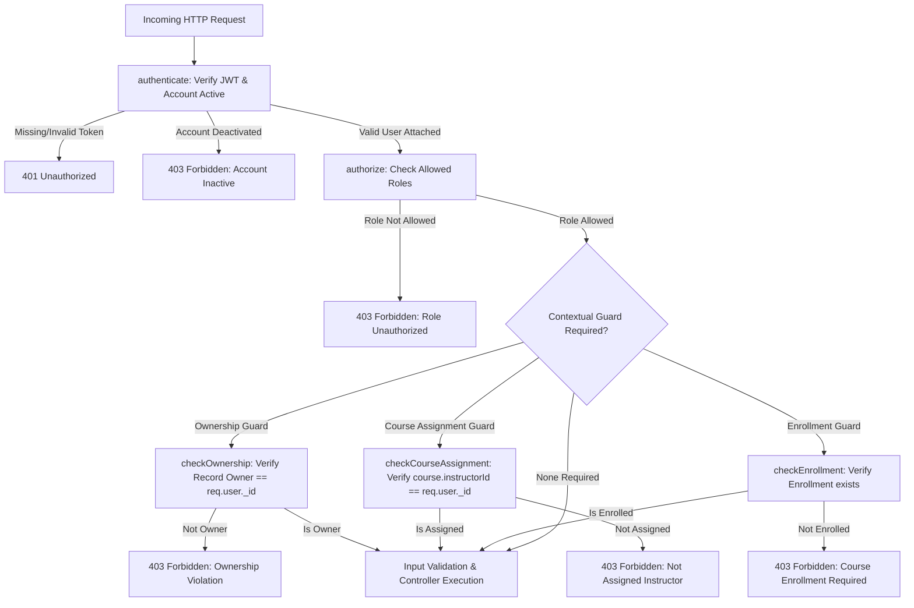

# CampusBridge API: Security, Authorization & Access-Control Architecture

## 1. Security Architecture Overview

CampusBridge implements defense-in-depth security spanning authentication, role-based access control (RBAC), fine-grained object ownership verification, contextual course-enrollment guards, and strict file validation.

The system reuses the centralized authentication middleware located in `server/src/middleware/auth.js` and adheres strictly to the SRS security specifications (SRS Section 9, SEC-01 through SEC-12).

---

## 2. The 10 Mandatory Security Rules

| # | Security Rule | Implementation Mechanism | Enforcement Layer |
|---|---|---|---|
| **1** | Students can only access and modify their own private records. | `checkOwnership((req) => req.user._id)` | Express route middleware & controller query filters |
| **2** | Students cannot access another student's submissions, grades, CV, or private progress. | Route-level student ID match; rejection with `403 Forbidden` | `checkOwnership` middleware & Mongoose queries |
| **3** | Instructors can only manage courses assigned to them. | Query verification: `course.instructorId.toString() === req.user._id.toString()` | `checkInstructorCourseAssignment` middleware |
| **4** | Instructors can only grade submissions belonging to their assigned courses. | Query joins submission -> assignment -> course, verifying instructor assignment | Grading controller & route middleware |
| **5** | Students must be actively enrolled before accessing enrollment-restricted course resources and assignments. | Verification against `Enrollment` collection `{ studentId, courseId }` | `checkStudentEnrollment` middleware |
| **6** | Coordinator-only operations remain Coordinator-only. | `authorize('coordinator')` | Route-level RBAC middleware |
| **7** | Administrator-only operations remain Administrator-only. | `authorize('admin')` | Route-level RBAC middleware |
| **8** | File upload restrictions enforced on backend, not just frontend. | Multer configuration + MIME type inspection + size limits | Upload middleware (`uploadCv`, `uploadSubmission`) |
| **9** | Never expose password hashes or sensitive user data. | Mongoose `select: false`, `.toJSON()` sanitization, redaction in logs | Model schema & JSON serialization |
| **10** | Validate all MongoDB ObjectIds, request bodies, and file inputs. | Schema-level validation, regex checks, and `mongoose.isValidObjectId` | Validation middleware & controller input sanitizers |

---

## 3. Middleware Security Pipeline

Every protected API request traverses a deterministic security pipeline before reaching the business controller:

---

## 4. Role Permission Matrix (Student & Instructor Operations)

| Endpoint Path | Method | Allowed Roles | Ownership / Context Guard |
|---|---|---|---|
| `/api/v1/student/profile` | GET | `student` | Own record (`req.user._id`) |
| `/api/v1/student/profile` | PUT | `student` | Own record (`req.user._id`) |
| `/api/v1/student/profile/cv` | POST, DELETE | `student` | Own record (`req.user._id`) |
| `/api/v1/student/courses` | GET | `student` | Public catalog (read-only) |
| `/api/v1/student/courses/:courseId` | GET | `student` | Active courses |
| `/api/v1/student/courses/:courseId/enroll` | POST | `student` | Duplicate enrollment check |
| `/api/v1/student/courses/enrolled` | GET | `student` | Filtered by `studentId: req.user._id` |
| `/api/v1/student/courses/:courseId/resources` | GET | `student` | Requires active enrollment in `courseId` |
| `/api/v1/student/courses/:courseId/assignments` | GET | `student` | Requires active enrollment in `courseId` |
| `/api/v1/student/assignments` | GET | `student` | Assignments for enrolled courses |
| `/api/v1/student/assignments/:assignmentId/submit` | POST | `student` | Enrolled in assignment's course; replaces own |
| `/api/v1/student/assignments/:assignmentId/submission` | GET | `student` | Own submission only |
| `/api/v1/student/progress` | GET | `student` | Own progress only |
| `/api/v1/student/internships` | GET | `student` | Open internships (read-only) |
| `/api/v1/student/internships/:id/apply` | POST | `student` | Own application; duplicate check |
| `/api/v1/student/applications` | GET | `student` | Own applications only |
| `/api/v1/student/applications/:id/withdraw` | POST | `student` | Own application; state must be non-terminal |
| `/api/v1/student/achievements` | GET | `student` | Own achievements |
| `/api/v1/student/rankings` | GET | `student` | Cohort scores with privacy anonymization |
| `/api/v1/student/projects` | GET, POST | `student` | Own projects only (ASM-02) |
| `/api/v1/student/projects/:id` | GET, PUT, DELETE | `student` | Own project only (ASM-02) |
| `/api/v1/student/tasks` | GET, POST | `student` | Own tasks only (ASM-02) |
| `/api/v1/student/tasks/:id` | GET, PUT, PATCH, DELETE | `student` | Own task only (ASM-02) |
| `/api/v1/instructor/profile` | GET, PUT | `instructor` | Own record (`req.user._id`) |
| `/api/v1/instructor/courses` | GET | `instructor` | Courses where `instructorId: req.user._id` |
| `/api/v1/instructor/courses/:courseId` | GET | `instructor` | Assigned course check |
| `/api/v1/instructor/courses/:courseId/students` | GET | `instructor` | Assigned course check |
| `/api/v1/instructor/courses/:courseId/stats` | GET | `instructor` | Assigned course check |
| `/api/v1/instructor/courses/:courseId/resources` | GET, POST | `instructor` | Assigned course check |
| `/api/v1/instructor/courses/:courseId/resources/:id` | PUT, DELETE | `instructor` | Assigned course check |
| `/api/v1/instructor/courses/:courseId/assignments` | GET, POST | `instructor` | Assigned course check |
| `/api/v1/instructor/assignments/:id` | GET, PUT, DELETE | `instructor` | Assigned course check |
| `/api/v1/instructor/grading-queue` | GET | `instructor` | Submissions for assigned courses |
| `/api/v1/instructor/submissions/:id/grade` | POST, PUT | `instructor` | Assigned course check |
| `/api/v1/instructor/courses/:courseId/at-risk` | GET | `instructor` | Assigned course check |

---

## 5. Privacy & Data Anonymization Standards

1. **Student Isolation**: No endpoint shall accept a `studentId` query or path parameter allowing an arbitrary student to view another student's submission, CV, private progress, or grade. `req.user._id` must always be injected as the student filter.
2. **Leaderboards**: The `/api/v1/student/rankings` endpoint returns an anonymized list of top performers (showing rank, masked name e.g. `J. D.`, score, and badges) while embedding the requesting student's exact personal ranking and score.
3. **Messaging Restrictions (ASM-05)**:
   - Students may initiate messages to:
     - Instructors who teach at least one course the student is currently enrolled in.
     - Platform Coordinators.
   - Students cannot message other students.
   - Attempts to message unauthorized recipients are rejected with `403 Forbidden` and message: `"Direct communication between students is not permitted."`
